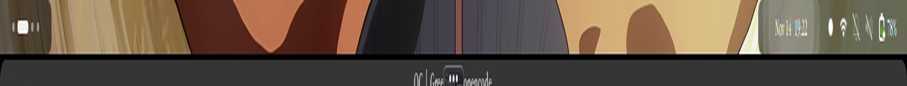
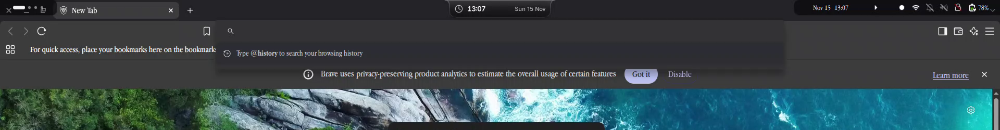
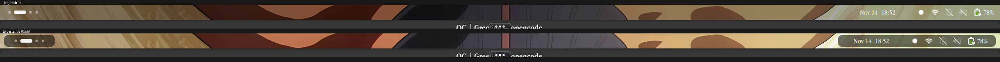
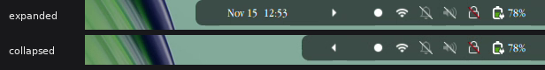

# Top Bar Islands

A two-island GNOME top bar in the SketchyBar / macOS style: a fully
transparent strip, a rounded translucent island on the left and one on the
right, white labels and icons, and an empty middle. Optionally the islands
float above your windows so applications can use the full screen height, and
the date/time can be collapsed into a chevron button.



## Features

- Two flush islands touching the top, left and right screen edges, with a
  completely transparent middle.
- Flat white items with a macOS-style hover wash. No gradients, no borders,
  no drop shadows, no text shadows.
- Optional **overlay mode**: the panel no longer reserves the top strip, so
  maximized windows reach `y=0` and the islands float above them. Clicks in the
  empty middle go to the window below; the islands stay clickable.
- Optional **collapsible clock**: a chevron beside the date/time hides it and
  leaves the status icons (network, battery, volume, Do Not Disturb) visible.
  The state survives reloads and unlocks.
- Four layout presets, switchable without restarting the shell.
- No daemon, no helper process, no polling. State is two small flag files.



*Overlay mode with a maximized browser: the page starts at `y=0` and the two
islands float above it. The clock in the middle belongs to the laptop's own
notch overlay, not to this extension.*

## Requirements

- GNOME Shell 45 to 50. Developed and tested on GNOME Shell 50.1, Ubuntu
  26.04.1 LTS, Wayland, at 1920x1080 with 1.5x scaling.
- `gnome-extensions` (part of GNOME Shell) for the helper scripts.

## Install

### From a release zip

```bash
gnome-extensions install --force topbar-islands@nyx.zip
gnome-extensions enable topbar-islands@nyx
```

On Wayland, log out and back in after installing a new extension. Wayland
cannot restart GNOME Shell in place.

### From source

```bash
git clone https://github.com/Neeraj-Parekh/gnome-topbar-islands.git
cd gnome-topbar-islands
./scripts/install.sh
```

`install.sh` copies the extension to
`~/.local/share/gnome-shell/extensions/topbar-islands@nyx`, installs the helper
scripts to `~/.local/bin`, and enables the extension. Add `--overlay` to turn
overlay mode on from the start, or `--no-enable` to only copy the files.

Then pick a layout:

```bash
topbar-mode.sh islands
```

### Uninstall

```bash
gnome-extensions disable topbar-islands@nyx
rm -rf ~/.local/share/gnome-shell/extensions/topbar-islands@nyx
rm -f ~/.local/bin/topbar-mode.sh ~/.local/bin/topbar-overlay.sh ~/.local/bin/topbar-clock.sh
rm -rf ~/.config/topbar-islands
```

## Layouts

| Preset | Look |
| --- | --- |
| `islands` | Two flush islands at 55% black. Default. |
| `islands-soft` | Two flush islands at 38% black, lighter over bright wallpaper. |
| `islands-floating` | The earlier floating variant: 3 px top margin, 8 px side margins. |
| `strip` | One full-width translucent strip at 32% black. |

```bash
topbar-mode.sh list
topbar-mode.sh islands-soft
```

Switching copies `presets/<name>.css` over `stylesheet.css` and reloads the
extension, which takes about a second.



## Overlay mode

By default the panel keeps its top strut, so maximized windows start below the
bar. Overlay mode removes that strut:

```bash
topbar-overlay.sh on
topbar-overlay.sh off
topbar-overlay.sh status
```

What it changes while on:

- the panel's tracked actor gets `affectsStruts = false`, so the work area is
  the full monitor;
- `Main.panel.reactive = false`, so clicks in the empty middle reach the
  window underneath;
- `#panelLeft` and `#panelRight` are made reactive again, so Activities, the
  clock and the status menus keep working;
- the stage input regions are recalculated with `layoutManager._updateRegions()`.

The flag is `~/.config/topbar-islands/overlay`. The running extension watches
the config directory, so the change applies immediately. No reload and no
shell unsafe mode are involved.

## Collapsible clock

If your laptop has a notch or another clock, you can hide the date/time and
keep only the status icons:

```bash
topbar-clock.sh hide
topbar-clock.sh show
topbar-clock.sh toggle
topbar-clock.sh status
```

A chevron appears beside the date/time (and becomes the leftmost item of the
right island when the clock is collapsed). Clicking it expands or contracts
the clock. The flag is
`~/.config/topbar-islands/clock-hidden`; the extension reapplies it after a
session mode change, so unlocking the screen does not bring the clock back.



## Theme

`theme/islands.css` is the same styling written for a GNOME Shell theme
(`#panel` instead of `#panel.topbar-islands`), for people who want the look
without the extension. A theme cannot remove the panel strut, pass clicks
through the middle, or provide the clock chevron. See
[`theme/README.md`](theme/README.md).

## How it works

The stylesheet makes `#panel` transparent and paints `#panelLeft` and
`#panelRight` as rounded surfaces. `#panelCenter` is left unpainted.

The extension adds the `topbar-islands` style class to the panel and, when the
overlay flag is present, edits the panel's entry in
`Main.layoutManager._trackedActors`. That is a private API: it is stable in
GNOME 45 to 50 but is not guaranteed across major shell releases. Disabling
the extension restores the original strut and reactivity.

The clock chevron is a `St.Button` inserted immediately after the date menu in
the panel's right box (or at the left edge of the right box if the date menu
lives in another box). Hiding the clock sets the date menu container
invisible; the button stays visible and flips its chevron.

## Repository layout

```
extension/            the GNOME Shell extension
  extension.js
  metadata.json
  stylesheet.css
  presets/            islands, islands-soft, islands-floating, strip
scripts/
  install.sh          install and enable
  build.sh            build dist/topbar-islands@nyx.zip
  topbar-mode.sh      switch layout preset
  topbar-overlay.sh   overlay on/off/status
  topbar-clock.sh     clock show/hide/toggle/status
theme/
  islands.css         shell theme snippet
  README.md
screenshots/
```

## Caveats

- GNOME imports an extension's JavaScript once per session. After editing
  `extension.js`, log out and back in; CSS preset changes only need the
  extension reload that `topbar-mode.sh` performs.
- Overlay mode relies on `Main.layoutManager._trackedActors`. If a future
  GNOME Shell changes that structure, the extension logs an error and leaves
  the panel untouched; disable the overlay flag to recover.
- The extension writes only inside `~/.config/topbar-islands/`. It does not
  modify system files.
- This is not published on extensions.gnome.org.

## License

MIT. See [LICENSE](LICENSE).
